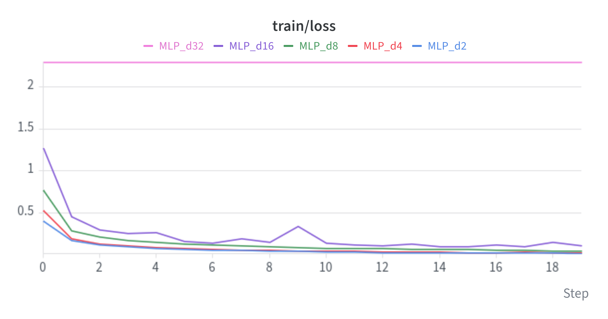
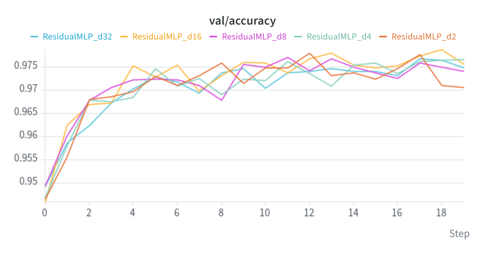
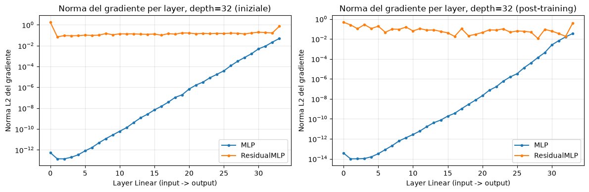
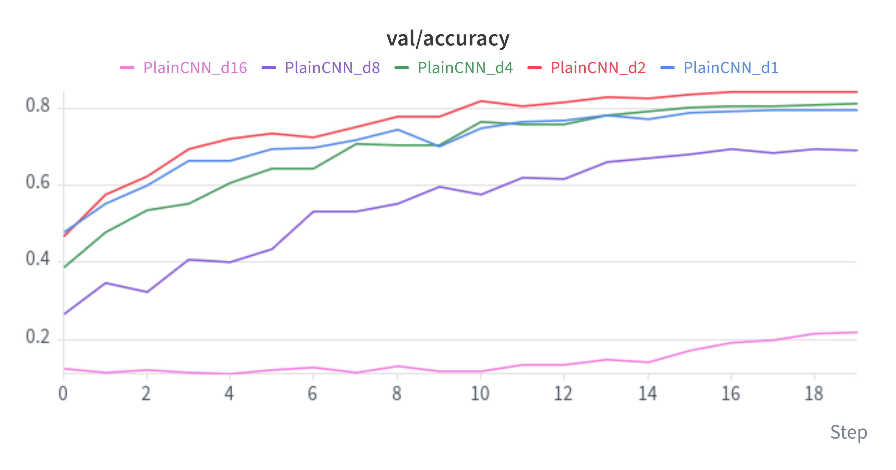
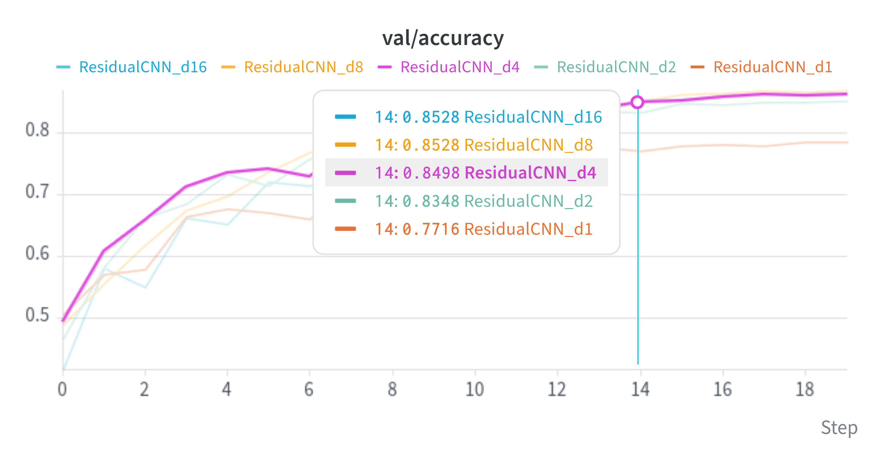
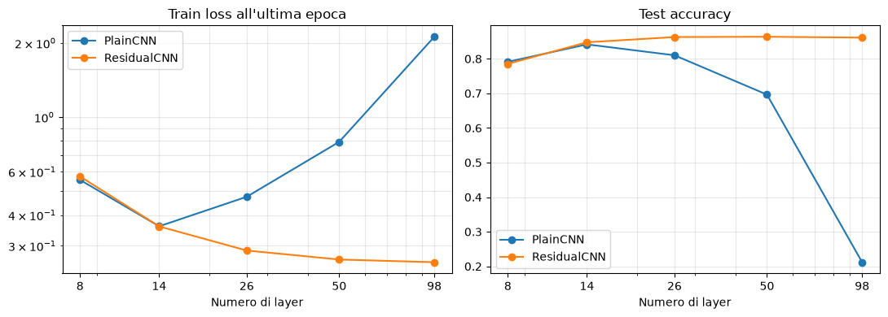
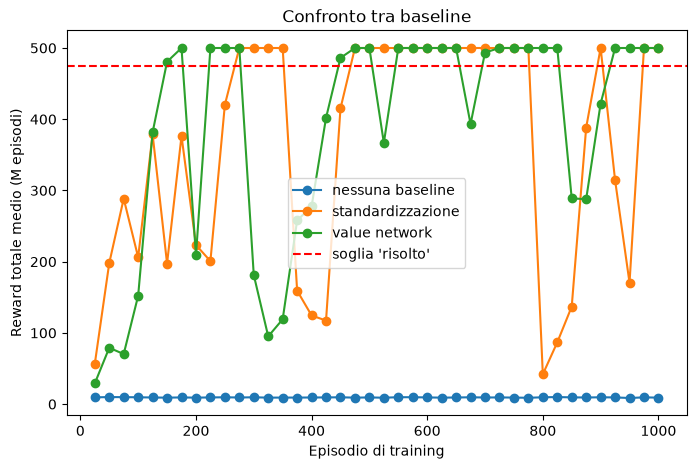
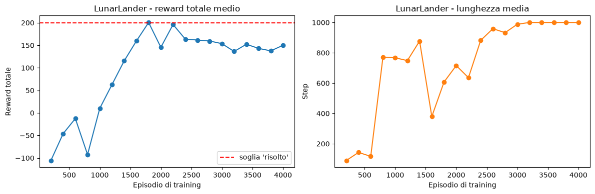
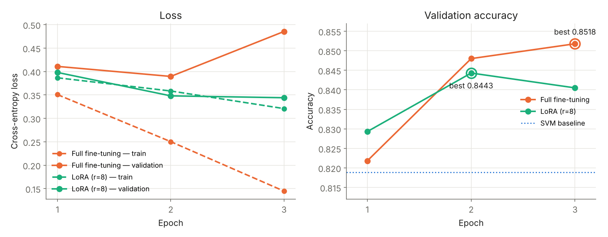
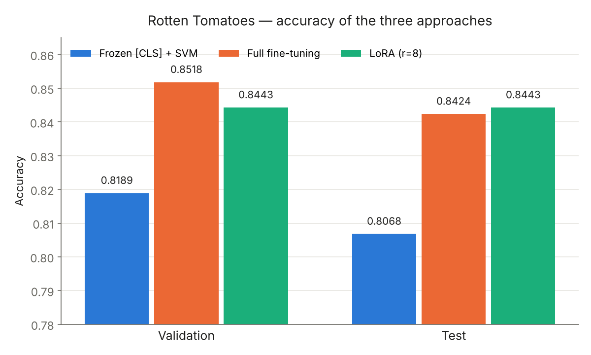

# Deep Learning Applications: Laboratories

## Lab 1: Convolutional Neural Networks

### Exercise 1.1: A baseline MLP

An MLP classifies MNIST digits, the network is composed of two hidden layer, trained for 20 epochs.

<details>
<summary><b>MLP implementation</b></summary>

```python
class MLP(nn.Module):
    def __init__(self, input_dim=28 * 28, hidden_dim=64, depth=1, num_classes=10):
        super().__init__()
        layers = [nn.Flatten(), nn.Linear(input_dim, hidden_dim), nn.ReLU()]
        for _ in range(depth):
            layers += [nn.Linear(hidden_dim, hidden_dim), nn.ReLU()]
        layers.append(nn.Linear(hidden_dim, num_classes))
        self.net = nn.Sequential(*layers)

    def forward(self, x):
        return self.net(x)
```

</details>

| Training loss | Training accuracy |
|:---:|:---:|
|  |  |
| **Validation loss** | **Validation accuracy** |
|  |  |

All networks converge within a few epochs. Depth does not help: the shallow networks reach about
97.5% validation accuracy, while the 16-layer one stays around 96% and trains less stably. Since the
deeper networks also have a higher training loss, deeper plain MLPs are
simply harder to optimize, which motivates residual connections.

### Exercise 1.2: Adding Residual Connections

ResidualMLP groups the hidden layers into residual blocks. For the same depth the plain and residual networks have the same layers, the same number
of parameters and, with the same seed, identical initial weights: the skip connections are the only
difference.

<details>
<summary><b>ResidualMLP implementation</b></summary>

```python
class ResidualMLPBlock(nn.Module):
    def __init__(self, dim, num_layers=2):
        super().__init__()
        layers = []
        for i in range(num_layers):
            layers.append(nn.Linear(dim, dim))
            if i < num_layers - 1:
                layers.append(nn.ReLU())
        self.f = nn.Sequential(*layers)
        self.act = nn.ReLU()

    def forward(self, x):
        return self.act(x + self.f(x))


class ResidualMLP(nn.Module):
    def __init__(self, input_dim=28 * 28, hidden_dim=64, depth=2, num_classes=10, layers_per_block=2):
        super().__init__()
        layers = [nn.Flatten(), nn.Linear(input_dim, hidden_dim), nn.ReLU()]
        layers += [ResidualMLPBlock(hidden_dim, layers_per_block) for _ in range(depth // layers_per_block)]
        layers.append(nn.Linear(hidden_dim, num_classes))
        self.net = nn.Sequential(*layers)

    def forward(self, x):
        return self.net(x)
```

</details>

| | Training loss | Validation accuracy |
|:---:|:---:|:---:|
| **MLP** |  |  |
| **ResidualMLP** |  |  |

The plain MLP degrades with depth, and with 32 hidden layers it does not learn at all: its training
loss stays at $\approx 2.30$ and its accuracy at about 0.1. With residual
connections every depth trains equally well (above 99% training and 97–98% validation accuracy), so
a 32-layer residual MLP is as easy to train as a 2-layer one, confirming the ResNet result. On an easy
dataset like MNIST it also show that deep networks are not so usefull and a simple MLP make a good work too on a dataset like MNIST.

#### Extra: Gradient analysis

To understand why the deep plain MLP fails, we measure the gradient norm of each linear layer on a
single training batch, for every network, before and after training.

<details>
<summary><b>Gradient analysis code</b></summary>

```python
def grad_norms_per_layer(model, x, y):
    model.zero_grad()
    nn.functional.cross_entropy(model(x), y).backward()
    return [m.weight.grad.norm().item() for m in model.modules() if isinstance(m, nn.Linear)]


train_loader = get_mnist(batch_size=config_12["batch_size"], val_set_size=config_12["val_set_size"],
                         seed=config_12["seed"])[0]
x, y = (t.to(device) for t in next(iter(train_loader)))

grad_norms = {}
for trained_model, _, cfg in results_12.values():
    torch.manual_seed(cfg["seed"])
    init_model = MODELS[cfg["architecture"]](
        **{k: cfg[k] for k in ("hidden_dim", "depth", "layers_per_block") if k in cfg}).to(device)
    for stage, model in [("iniziale", init_model), ("post-training", trained_model)]:
        grad_norms[(cfg["architecture"], cfg["depth"], stage)] = grad_norms_per_layer(model, x, y)

ratios = pd.Series({k: norms[1] / norms[-2] for k, norms in grad_norms.items()}).unstack([2, 0])
```

</details>



| Depth | MLP (initial) | MLP (trained) | ResidualMLP (initial) | ResidualMLP (trained) |
|:---:|:---:|:---:|:---:|:---:|
| 2  | 1.07 | 1.45 | 1.03 | 2.24 |
| 4  | 0.51 | 2.86 | 0.83 | 2.39 |
| 8  | 1.5 × 10⁻² | 5.02 | 0.67 | 2.35 |
| 16 | 1.6 × 10⁻⁵ | 5.79 | 0.64 | 5.81 |
| 32 | 6.4 × 10⁻¹² | 6.2 × 10⁻¹³ | 0.42 | 13.99 |

*Ratio between the gradient norm of the first and the last hidden layer*

The plain MLP suffers from vanishing gradients: the norm decays from the output to
the input by about 10 orders of magnitude with 32 layers.
In plain MLPs, the gradient is attenuated at every layer as it flows back towards the input: the deeper the network, the weaker it is when it reaches the first layers,
until it prevents them from being trained. In MLPs with skip connections, the gradient has a direct path through which it reaches the first layers without being attenuated, at any depth.

### Exercise 1.3: Rinse and Repeat (but with a CNN)

The same comparison is repeated with CNNs on CIFAR-10. Both networks follow the CIFAR ResNet of the
original paper. The residual CNN uses torchvision's BasicBlock, the plain CNN uses PlainBlock, the same layers without the
skip connection. As before, both start from identical weights.

<details>
<summary><b>CNN implementation</b></summary>

```python
class PlainBlock(nn.Module):
    def __init__(self, inplanes, planes, stride=1, downsample=None):
        super().__init__()
        self.f = nn.Sequential(
            nn.Conv2d(inplanes, planes, 3, stride, 1, bias=False), nn.BatchNorm2d(planes), nn.ReLU(inplace=True),
            nn.Conv2d(planes, planes, 3, 1, 1, bias=False), nn.BatchNorm2d(planes), nn.ReLU(inplace=True),
        )

    def forward(self, x):
        return self.f(x)


class CIFARNet(nn.Module):
    def __init__(self, block, depth=1, base_channels=16, num_classes=10):
        super().__init__()
        c = base_channels
        self.stem = nn.Sequential(nn.Conv2d(3, c, 3, 1, 1, bias=False), nn.BatchNorm2d(c), nn.ReLU(inplace=True))
        layers, in_ch = [], c
        for out_ch, stride in [(c, 1), (2 * c, 2), (4 * c, 2)]:
            downsample = None if (stride == 1 and in_ch == out_ch) else nn.Sequential(
                nn.Conv2d(in_ch, out_ch, 1, stride, bias=False), nn.BatchNorm2d(out_ch))
            layers.append(block(in_ch, out_ch, stride, downsample))
            layers += [block(out_ch, out_ch) for _ in range(depth - 1)]
            in_ch = out_ch
        self.stages = nn.Sequential(*layers)
        self.fc = nn.Linear(4 * c, num_classes)

    def feature_maps(self, x):
        return self.stages(self.stem(x))

    def forward(self, x):
        return self.fc(self.feature_maps(x).mean(dim=(2, 3)))


MODELS["PlainCNN"] = lambda **kw: CIFARNet(PlainBlock, **kw)
MODELS["ResidualCNN"] = lambda **kw: CIFARNet(BasicBlock, **kw)
```

</details>

| | Training loss | Validation accuracy |
|:---:|:---:|:---:|
| **PlainCNN** |  |  |
| **ResidualCNN** |  |  |

`d1` … `d16` correspond to 8, 14, 26, 50 and 98 layers.



Deeper plain CNNs do not always work better: the best one has 14 layers (84% test accuracy),
then accuracy drops to 81%, 70% and 21% at 98 layers, with the training loss following the same
trend, the degradation problem again.
Even deeper residual CNNs do work better: accuracy grows with depth from 79% to about 86% and
the training loss keeps decreasing. Unlike MNIST, CIFAR-10 is hard enough for extra depth to be
useful, but only when the network can be trained.

### Exercise 2.3: Explaining the predictions of a CNN

Using the best ResidualCNN from Exercise 1.3, the notebook implements CAM to visualize which image regions drive each classification decision, 
and compares it with a ResNet-18 pre-trained on ImageNet, applied to Imagenette.

<details>
<summary><b>CAM implementation</b></summary>

```python
def compute_cam(feature_fn, fc, images):
    with torch.no_grad():
        fmaps = feature_fn(images)
        preds = fc(fmaps.mean(dim=(2, 3))).argmax(dim=1)
        weights = fc.weight[preds]
        cams = torch.einsum("bkhw,bk->bhw", fmaps, weights).clamp(min=0)
        cams = cams - cams.amin(dim=(1, 2), keepdim=True)
        cams = cams / (cams.amax(dim=(1, 2), keepdim=True) + 1e-8)
        cams = nn.functional.interpolate(cams[:, None], size=images.shape[-2:],
                                         mode="bilinear", align_corners=False)
    return cams[:, 0].cpu(), preds.cpu()


cams, preds = compute_cam(cifar_model.feature_maps, cifar_model.fc, images)

resnet_trunk = nn.Sequential(*list(resnet.children())[:-2])
cams, preds = compute_cam(resnet_trunk, resnet.fc, images)
```

</details>


Both models attend to the objects rather than the background, the ResidualCNN produces maps centred on the cat, the ships, the frogs and even the airplane printed on a poster,
while the pre-trained ResNet-18 highlights the discriminative parts of each object

Both networks focus on the objects rather than the background: the cat, the ships, the airplane on
the poster, the body of the tench (not the hand), the face of the dog, the French horn. The maps
also explain the mistakes: the chain saw becomes a lumbermill because the network looks at the
whole woodworking scene, and the gas pump becomes an oxygen mask because it focuses on the hand
in the foreground.


## Lab 2: Deep Reinforcement Learning

### Exercise 1: Improving the REINFORCE implementation

The goal of this exercise is to get REINFORCE working on
[CartPole](https://gymnasium.farama.org/environments/classic_control/cart_pole/) and to replace the
running average of training rewards, a noisy and misleading metric, with a proper evaluation
protocol. The original implementation is refactored into a small `src/` package (`policy.py` for the
networks, `reinforce.py` for the algorithm, `viz.py` for plots and animations).

The policy is an MLP with one hidden layer of 128 units that maps the state to the logits of the
actions; actions are sampled from the resulting categorical distribution. After each episode the
discounted returns $G_t$ are computed and the policy is updated by minimizing
$-\frac{1}{T}\sum_t \log \pi(a_t \mid s_t)\, G_t$. Every `N` training episodes the training is
paused and the current policy is run for `M` episodes without updating the weights, collecting the
**average total reward** and the **average episode length**.

<details>
<summary><b>Evaluation and training loop</b> (click to expand)</summary>

```python
@torch.no_grad()
def evaluate_policy(env, policy, M):
    total_rewards, lengths = [], []
    for _ in range(M):
        _, _, rewards = run_episode(env, policy)
        total_rewards.append(sum(rewards))
        lengths.append(len(rewards))
    return sum(total_rewards) / M, sum(lengths) / M


def reinforce(env, policy, num_episodes=1000, gamma=0.99, lr=1e-2, N=25, M=10,
              standardize=True, value_net=None):
    optimizer = torch.optim.Adam(policy.parameters(), lr=lr)
    if value_net is not None:
        value_optimizer = torch.optim.Adam(value_net.parameters(), lr=lr)
    eval_episodes, eval_rewards, eval_lengths = [], [], []

    for episode in range(1, num_episodes + 1):
        states, log_probs, rewards = run_episode(env, policy)
        returns = compute_returns(rewards, gamma)
        weights = returns

        if value_net is not None:
            values = value_net(states)
            weights = returns - values.detach()
            value_optimizer.zero_grad()
            F.mse_loss(values, returns).backward()
            value_optimizer.step()

        if standardize and len(weights) > 1:
            weights = (weights - weights.mean()) / (weights.std() + 1e-8)

        loss = -(log_probs * weights).mean()
        optimizer.zero_grad()
        loss.backward()
        optimizer.step()

        if episode % N == 0:
            avg_reward, avg_length = evaluate_policy(env, policy, M)
            eval_episodes.append(episode)
            eval_rewards.append(avg_reward)
            eval_lengths.append(avg_length)
            print(f"Episode {episode} | avg reward: {avg_reward:.1f} | avg length: {avg_length:.1f}")

    return eval_episodes, eval_rewards, eval_lengths
```

</details>

The agent is trained for 1000 episodes and evaluated every `N = 25` episodes over `M = 10` episodes.
As in the original implementation, returns are standardized within each episode (the effect of this
choice is studied in Exercise 2).


In CartPole the agent receives +1 for every step the pole stays up, so the average total reward and
the average episode length coincide, both curves rise together, reaching the maximum of 500 around episode 525.
Training is not stable, though: the evaluation suddenly drops to 69 around episode 675 and again to about 200–240 at the end.
The periodic evaluation makes these collapses, caused by the high variance of REINFORCE, clearly visible, while a running average would smooth them out. 
They motivate the baselines of Exercise 2.


### Exercise 2: REINFORCE with a value baseline

Subtracting from the return $G_t$ any baseline that does not depend on the action leaves the expected
gradient unchanged but can greatly reduce its variance. The exercise compares three variants on
CartPole, all starting from the same seed and the same initial weights:

- **no baseline**: the raw returns $G_t$ are used;
- **standardization**: the returns are standardized within each episode, a baseline that is constant
  for the whole episode (the default of the original implementation);
- **value network**: a second network $\tilde{v}(s \mid \mathbf{w})$, with the same architecture as
  the policy but a single output, estimates the value of each state and the policy is updated with
  $G_t - \tilde{v}(s_t)$. The value network is trained separately, by regression on the returns.

<details>
<summary><b>Value network and baseline</b> (click to expand)</summary>

```python
class ValueNet(nn.Module):
    def __init__(self, env, hidden_dim=128):
        super().__init__()
        self.net = nn.Sequential(
            nn.Linear(env.observation_space.shape[0], hidden_dim),
            nn.ReLU(),
            nn.Linear(hidden_dim, 1),
        )

    def forward(self, state):
        return self.net(state).squeeze(-1)


if value_net is not None:
    values = value_net(states)
    weights = returns - values.detach()
    value_optimizer.zero_grad()
    F.mse_loss(values, returns).backward()
    value_optimizer.step()


def train(standardize, value_baseline=False):
    torch.manual_seed(SEED)
    env.reset(seed=SEED)
    policy = PolicyNet(env)
    value_net = ValueNet(env) if value_baseline else None
    return reinforce(env, policy, num_episodes=1000, N=25, M=10,
                     standardize=standardize, value_net=value_net)


episodes, rewards_std, _ = train(standardize=True)
_, rewards_raw, _ = train(standardize=False)
_, rewards_value, _ = train(standardize=False, value_baseline=True)
```

</details>



Without a baseline the policy collapses in the first episodes and never recovers. Standardization reaches 500 from episode
275, but with several sudden collapses. The value network performs best: it reaches 500 already at
episode 175 and its drops are shorter.


### Exercise 3.1: Lunar Lander with REINFORCE

The same implementation is applied to
[Lunar Lander](https://gymnasium.farama.org/environments/box2d/lunar_lander/), a harder environment:
the state has 8 components, there are 4 actions (do nothing, fire the left, main or right engine) and
an episode lasts at most 1000 steps. The agent is rewarded for landing softly between the two flags
(with a +100 bonus when it comes to rest), penalized for crashing (−100) and for every frame an engine
is firing; the environment is considered solved at an average reward of 200. Unlike CartPole, here
the average reward and the average episode length are different metrics: a long episode can mean
that the lander hovers without landing.

The agent uses the value network baseline of Exercise 2, which was the most stable variant, without
standardization and with a learning rate of 3e-3; it is trained for 4000 episodes and evaluated every
200 episodes over 10 episodes.

<details>
<summary><b>Lunar Lander training</b> (click to expand)</summary>

```python
@torch.no_grad()
def evaluate_policy(env, policy, M):
    total_rewards, lengths = [], []
    for _ in range(M):
        _, _, rewards = run_episode(env, policy)
        total_rewards.append(sum(rewards))
        lengths.append(len(rewards))
    return sum(total_rewards) / M, sum(lengths) / M


def reinforce(env, policy, num_episodes=1000, gamma=0.99, lr=1e-2, N=25, M=10,
              standardize=True, value_net=None):
    optimizer = torch.optim.Adam(policy.parameters(), lr=lr)
    if value_net is not None:
        value_optimizer = torch.optim.Adam(value_net.parameters(), lr=lr)
    eval_episodes, eval_rewards, eval_lengths = [], [], []

    for episode in range(1, num_episodes + 1):
        states, log_probs, rewards = run_episode(env, policy)
        returns = compute_returns(rewards, gamma)
        weights = returns

        if value_net is not None:  # value baseline, used from Exercise 2
            values = value_net(states)
            weights = returns - values.detach()
            value_optimizer.zero_grad()
            F.mse_loss(values, returns).backward()
            value_optimizer.step()

        if standardize and len(weights) > 1:
            weights = (weights - weights.mean()) / (weights.std() + 1e-8)

        loss = -(log_probs * weights).mean()
        optimizer.zero_grad()
        loss.backward()
        optimizer.step()

        if episode % N == 0:
            avg_reward, avg_length = evaluate_policy(env, policy, M)
            eval_episodes.append(episode)
            eval_rewards.append(avg_reward)
            eval_lengths.append(avg_length)
            print(f"Episode {episode} | avg reward: {avg_reward:.1f} | avg length: {avg_length:.1f}")

    return eval_episodes, eval_rewards, eval_lengths
```


</details>



The average reward grows from about −106, when the lander crashes within 90 steps, to the "solved"
threshold, which it reaches once at episode 1800. After that it settles between 135 and 165,
while the episode length rises to the 1000-step limit from episode 3200 on. The agent has learned
the safe part of the task, slowing down and staying near the landing pad without crashing, but not
to switch the engines off: it hovers until the time runs out, which the video of the trained agent
confirms. This local optimum, where avoiding the −100 crash is easier to learn than earning the +100
landing bonus.


## Lab 3: Transformers and HuggingFace

The lab builds a sentiment classifier on the
[Rotten Tomatoes](https://huggingface.co/datasets/cornell-movie-review-data/rotten_tomatoes) movie
review dataset around [DistilBERT](https://huggingface.co/distilbert/distilbert-base-uncased),
and compares three ways of using the pre-trained model: as a frozen feature extractor, fully
fine-tuned, and fine-tuned efficiently with LoRA. The fine-tuning runs are logged on Weights & Biases.

### Exercise 1: A stable baseline

**Dataset (1.1).** Rotten Tomatoes has three splits (8530 training, 1066 validation and 1066 test
sentences) and two perfectly balanced classes, `neg` and `pos`.

<details>
<summary><b>Loading the dataset</b> (click to expand)</summary>

```python
DATASET = "cornell-movie-review-data/rotten_tomatoes"
dataset = load_dataset(DATASET)
label_names = dataset["train"].features["label"].names  # ["neg", "pos"]

for split in dataset:
    counts = Counter(dataset[split]["label"])
    print(f"{split}: {len(dataset[split])} sentences | "
          + " | ".join(f"{label_names[k]}: {counts[k]}" for k in sorted(counts)))
```

</details>

**Model and tokenizer (1.2).** The tokenizer splits each sentence into sub-word tokens and adds the
special `[CLS]` and `[SEP]` tokens; with `padding=True` the sentences of a batch are padded to the
longest one, and the `attention_mask` marks the padding positions. DistilBERT returns a
768-dimensional vector for every token (`last_hidden_state` has shape `(batch, tokens, 768)`), and the
vector of the first token, `[CLS]`, is used as a summary of the whole sentence.

<details>
<summary><b>Tokenizer and model</b> (click to expand)</summary>

```python
MODEL_NAME = "distilbert/distilbert-base-uncased"
tokenizer = AutoTokenizer.from_pretrained(MODEL_NAME)
model = AutoModel.from_pretrained(MODEL_NAME).to(device).eval()  # encoder without a classification head

samples = dataset["train"][:3]["text"]
inputs = tokenizer(samples, padding=True, truncation=True, return_tensors="pt").to(device)
with torch.no_grad():
    outputs = model(**inputs)

print(outputs.last_hidden_state.shape)        # (3, tokens, 768)
print(outputs.last_hidden_state[:, 0].shape)  # [CLS] vectors: (3, 768)
```

</details>

**Baseline (1.3).** A `feature-extraction` pipeline extracts the `[CLS]` vector of the last layer of
the frozen DistilBERT for every sentence, and a linear SVM is trained on top of these features.

<details>
<summary><b>Feature extraction and SVM</b> (click to expand)</summary>

```python
extractor = pipeline("feature-extraction", model=model, tokenizer=tokenizer, device=device)


def extract_cls(split):
    outs = extractor(KeyDataset(dataset[split], "text"), batch_size=64,
                     return_tensors=True, tokenize_kwargs={"truncation": True})
    X = np.stack([out[0, 0].cpu().numpy() for out in outs])
    return X, np.array(dataset[split]["label"])


X_train, y_train = extract_cls("train")
X_val, y_val = extract_cls("validation")
X_test, y_test = extract_cls("test")

clf = SVC(kernel="linear").fit(X_train, y_train)
baseline_val_acc = accuracy_score(y_val, clf.predict(X_val))
baseline_test_acc = accuracy_score(y_test, clf.predict(X_test))
```

</details>

The baseline reaches **81.9% validation accuracy and 80.7% test accuracy**. DistilBERT's weights
are never updated here, so this measures how useful the generic pre-trained representation already
is for sentiment classification: any gain of the following exercises comes from adapting the model to
the task.

### Exercise 2: Fine-tuning DistilBERT

The splits are tokenized with `Dataset.map(..., batched=True)`, which adds `input_ids` and
`attention_mask` to every example. Only truncation is applied at this stage: padding is left to a
`DataCollatorWithPadding`, which pads each batch to its longest sentence. The model is
`AutoModelForSequenceClassification`, which adds to DistilBERT a new, randomly initialized
classification head (`pre_classifier` + `classifier`) on top of the `[CLS]` token. It is trained end
to end for 3 epochs with the HuggingFace `Trainer`, evaluating accuracy, precision, recall and F1 on
the validation set after every epoch and restoring at the end the checkpoint with the best accuracy.

<details>
<summary><b>Tokenization, model and Trainer</b> (click to expand)</summary>

```python
def tokenize(batch):
    return tokenizer(batch["text"], truncation=True)  # padding is done per batch by the collator


tokenized = dataset.map(tokenize, batched=True)

ft_model = AutoModelForSequenceClassification.from_pretrained(
    MODEL_NAME, num_labels=2,
    id2label=dict(enumerate(label_names)),
    label2id={name: i for i, name in enumerate(label_names)},
).to(device)

data_collator = DataCollatorWithPadding(tokenizer=tokenizer)


def compute_metrics(eval_pred):
    logits, labels = eval_pred
    preds = np.argmax(logits, axis=-1)
    precision, recall, f1, _ = precision_recall_fscore_support(labels, preds, average="binary")
    return {"accuracy": accuracy_score(labels, preds), "precision": precision, "recall": recall, "f1": f1}


os.environ["WANDB_PROJECT"] = "dla-lab3-es2.3"
training_args = TrainingArguments(
    output_dir="checkpoints/distilbert-rotten-tomatoes",
    learning_rate=2e-5,
    per_device_train_batch_size=16,
    per_device_eval_batch_size=64,
    num_train_epochs=3,
    weight_decay=0.01,
    eval_strategy="epoch",
    save_strategy="epoch",
    save_total_limit=1,
    load_best_model_at_end=True,
    metric_for_best_model="accuracy",
    logging_steps=100,
    fp16=torch.cuda.is_available(),
    report_to="wandb",
    run_name="distilbert_full_ft",
    seed=SEED,
)
trainer = Trainer(
    model=ft_model,
    args=training_args,
    train_dataset=tokenized["train"],
    eval_dataset=tokenized["validation"],
    data_collator=data_collator,
    compute_metrics=compute_metrics,
)

trainer.train()
val_metrics = trainer.evaluate()
test_metrics = trainer.evaluate(tokenized["test"], metric_key_prefix="test")
```

</details>

| Epoch | Train loss | Val loss | Accuracy | Precision | Recall | F1 |
|---|---|---|---|---|---|---|
| 1 | 0.351 | 0.411 | 0.822 | 0.763 | 0.932 | 0.840 |
| 2 | 0.250 | 0.389 | 0.848 | 0.833 | 0.871 | 0.851 |
| 3 | 0.145 | 0.485 | **0.852** | 0.845 | 0.861 | 0.853 |

Fine-tuning reaches **85.2% validation accuracy and 84.2% test accuracy**, +3.6 points over the
frozen baseline on the test set. After the first epoch the model is biased towards the positive
class (recall 0.93, precision 0.76); precision and recall become balanced in the following epochs
(0.837 and 0.850 on the test set). From epoch 2 the validation loss rises while the training loss
keeps falling: the model overfits in its confidence, but the accuracy still improves, which is why the
best checkpoint is selected on accuracy rather than on loss.

### Exercise 3.1: Efficient fine-tuning with LoRA

[LoRA](https://huggingface.co/docs/peft/en/package_reference/lora), from the HuggingFace
[PEFT](https://huggingface.co/docs/peft/en/index) library, keeps all the pre-trained weights frozen
and learns a low-rank update $\Delta W = BA$ (rank $r = 8$) for the query and value projections of
every attention layer. The classification head is new, so it is trained in full
(`modules_to_save`). The training pipeline is the same as in Exercise 2: only the model, the learning
rate (higher, 2e-4, as usual for LoRA) and the output folder change.

<details>
<summary><b>LoRA configuration and training</b> (click to expand)</summary>

```python
base_model = AutoModelForSequenceClassification.from_pretrained(
    MODEL_NAME, num_labels=2,
    id2label=dict(enumerate(label_names)), label2id={l: i for i, l in enumerate(label_names)},
)

lora_config = LoraConfig(
    task_type=TaskType.SEQ_CLS,
    r=8,
    lora_alpha=16,
    lora_dropout=0.1,
    target_modules=["q_lin", "v_lin"],                 # query and value projections
    modules_to_save=["pre_classifier", "classifier"],  # the new head is trained in full
)
peft_model = get_peft_model(base_model, lora_config)
peft_model.print_trainable_parameters()
# trainable params: 739,586 || all params: 67,694,596 || trainable%: 1.0925

# Same TrainingArguments as Exercise 2, except for:
#   output_dir="checkpoints/distilbert-lora-rotten-tomatoes", learning_rate=2e-4,
#   run_name="distilbert_lora_r8" (W&B project "dla-lab3-es3.1")
peft_trainer = Trainer(
    model=peft_model,
    args=peft_args,
    train_dataset=tokenized["train"],
    eval_dataset=tokenized["validation"],
    data_collator=data_collator,
    compute_metrics=compute_metrics,
)
peft_train = peft_trainer.train()
peft_val = peft_trainer.evaluate()
peft_test = peft_trainer.evaluate(tokenized["test"], metric_key_prefix="test")
```

</details>

Only **1.1% of the parameters** are trained (739,586), and most of them belong to the head: the LoRA
matrices themselves are 147,456 parameters, 0.2% of the model.



With LoRA the validation loss decreases at every epoch (0.398 → 0.348 → 0.344): with so few free
parameters the model does not overfit. The best checkpoint is the one of epoch 2.



| Method | Trained parameters | Val acc | Test acc | Training time |
|---|---|---|---|---|
| Frozen `[CLS]` + SVM | 0 (DistilBERT) | 0.8189 | 0.8068 | — |
| Full fine-tuning | 67M (100%) | 0.8518 | 0.8424 | 81 s |
| LoRA ($r = 8$) | 0.74M (1.1%) | 0.8443 | 0.8443 | 57 s |

LoRA matches full fine-tuning: it is 0.8 points lower on the validation set and 0.2 points higher on
the test set, differences that are within the noise of 1066-example splits. Training is 30% faster,
since the forward pass still goes through the whole of DistilBERT; the larger saving is in memory and
storage, because only the small adapter and the head need gradients, optimizer states and a saved
checkpoint.

